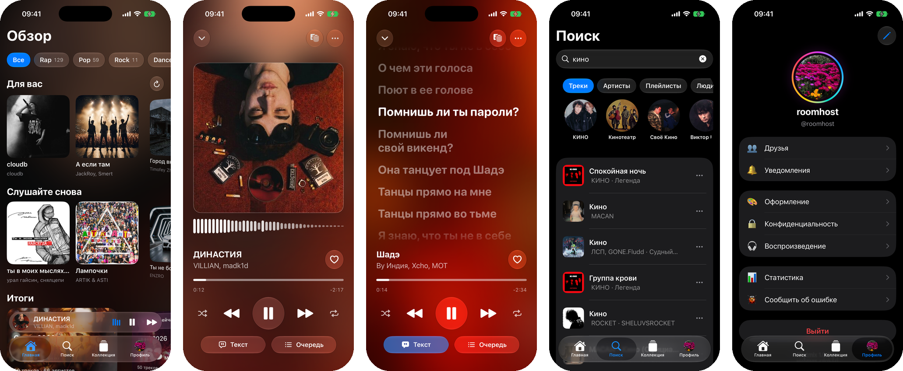

# Rhytmix для iOS и Android

Музыка из Яндекс Музыки, SoundCloud и YouTube в одном плеере на телефоне.

## Что умеет

- Поиск сразу по трём источникам, в том числе по строчке из песни
- Тексты с подсветкой текущей строки
- Любимое, плейлисты, импорт плейлиста по ссылке
- Скачивание для офлайна: без сети приложение само переходит на скачанное
- Эквалайзер, плавный переход между треками, таймер сна
- Совместное прослушивание по коду комнаты и управление другим устройством
- Друзья, профили, итоги сезона и года
- Темы: каталог, свой фон с кадрированием, обмен файлами тем с десктопом

Приложение нативное: SwiftUI на iOS, Jetpack Compose на Android, общее ядро на Rust.

## Скачать

Файлы — в [последнем релизе](https://github.com/salenyo/lamusica-mobile-releases/releases/latest).

| Платформа | Файл |
|---|---|
| Android 8 и новее, любой телефон | `Rhytmix-<версия>-android.apk` |
| Android, 64-битный телефон, файл меньше | `Rhytmix-<версия>-android-arm64.apk` |
| Android, старый 32-битный телефон | `Rhytmix-<версия>-android-armv7.apk` |
| iPhone с iOS 16 и новее | `Rhytmix-<версия>-ios.ipa` |

Не знаете, какой Android-файл взять, — берите первый, он работает везде.

Релизы с пометкой **Pre-release** и версией вида `1.0.0-nightly.42` — ночные сборки: в них
раньше появляется новое, но они могут быть нестабильными.

## Android

1. Скачайте `.apk` на телефон и откройте его.
2. Разрешите установку из этого источника, когда Android спросит.

Новая версия ставится тем же способом поверх старой — данные и вход сохраняются.

## iOS

В App Store приложения нет, а `.ipa` не подписан: подписывает его ваш Apple ID через
[AltStore](https://altstore.io) или [SideStore](https://sidestore.io).

1. Поставьте AltServer на компьютер (Windows или macOS), подключите iPhone кабелем и через меню
   AltServer установите AltStore.
2. На iPhone: **Настройки → Основные → VPN и управление устройством** → ваш профиль →
   **Доверять**.
3. Скачайте `.ipa` на телефон, в AltStore откройте **My Apps → +** и выберите файл.

С бесплатным Apple ID подпись живёт 7 дней: AltStore продлевает её сам, когда телефон и компьютер
в одной сети. SideStore после первой настройки продлевает подпись без компьютера. Обновление —
установка нового `.ipa` поверх старого.

Если у вас стоит старая версия 0.7 (до нативного приложения), новая встанет рядом с ней отдельным
приложением: удалите старое и войдите заново — лайки и плейлисты хранятся в аккаунте.

## Аккаунт

Общий с [десктопной версией](https://github.com/salenyo/rhytmix-releases): лайки, плейлисты и
история синхронизируются.

---

Нашли проблему — [заведите issue](https://github.com/salenyo/lamusica-mobile-releases/issues)
или отправьте отчёт из приложения: **Профиль → Сообщить об ошибке**.

