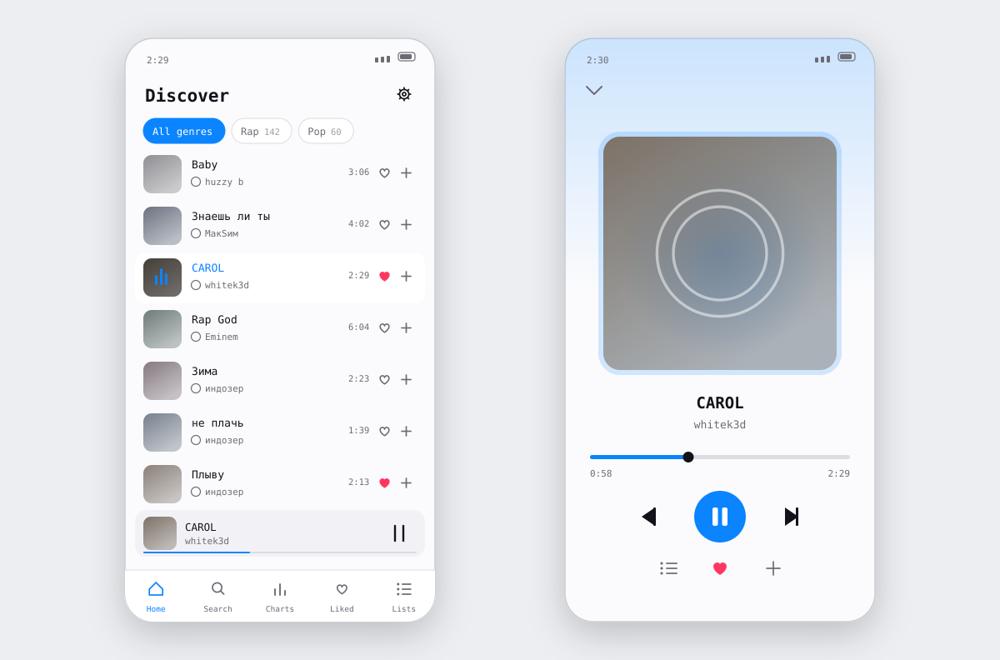

# lamusica для Android

Мобильный плеер: поиск и прослушивание из YouTube, SoundCloud и Яндекс.Музыки
прямо с телефона — с фоновым воспроизведением и офлайн-кешем.

<picture>
  <source media="(prefers-color-scheme: dark)" srcset="docs/preview-dark.svg">
  
</picture>

## Возможности

- Поиск по YouTube, SoundCloud и Яндекс.Музыке из одной строки
- Лайки, плейлисты, фильтр по жанрам
- Чарты и рекомендации по прослушанному
- Текст песни с подсветкой строки под текущий момент
- 10-полосный эквалайзер с пресетами и визуализатор
- Музыка играет в фоне, управление — из шторки и с наушников
- Кеш треков с настраиваемым лимитом: прослушанное открывается без сети
- Светлая и тёмная темы, пять языков интерфейса
- Встроенное обновление

## Установка

| Шаг | Что сделать |
|-----|-------------|
| **1** | Скачайте `lamusica-<версия>.apk` из [последнего релиза](https://github.com/salenyo/lamusica-mobile-releases/releases/latest) |
| **2** | Откройте файл на телефоне — Android спросит разрешение на установку из этого источника |
| **3** | Разрешите и подтвердите установку |

Требуется **Android 7.0** и новее. Собрано под `arm64-v8a` и `armeabi-v7a` — это
подавляющее большинство телефонов; версии для iOS пока нет.

### [⬇ Скачать последнюю версию](https://github.com/salenyo/lamusica-mobile-releases/releases/latest)

## Обновления

В настройках, на вкладке «О приложении», есть кнопка проверки. Новая версия
скачивается внутри приложения и передаётся системному установщику — искать APK
вручную не нужно.

## Аккаунт

Аккаунт общий с десктопной версией: плейлисты, лайки и история синхронизируются.
Регистрация пока по бета-коду — его выдаёт администратор.

---

Десктопная версия — [lamusica-releases](https://github.com/salenyo/lamusica-releases).

Проект в стадии **беты**. Нашли проблему или есть идея —
[заведите issue](https://github.com/salenyo/lamusica-mobile-releases/issues).

